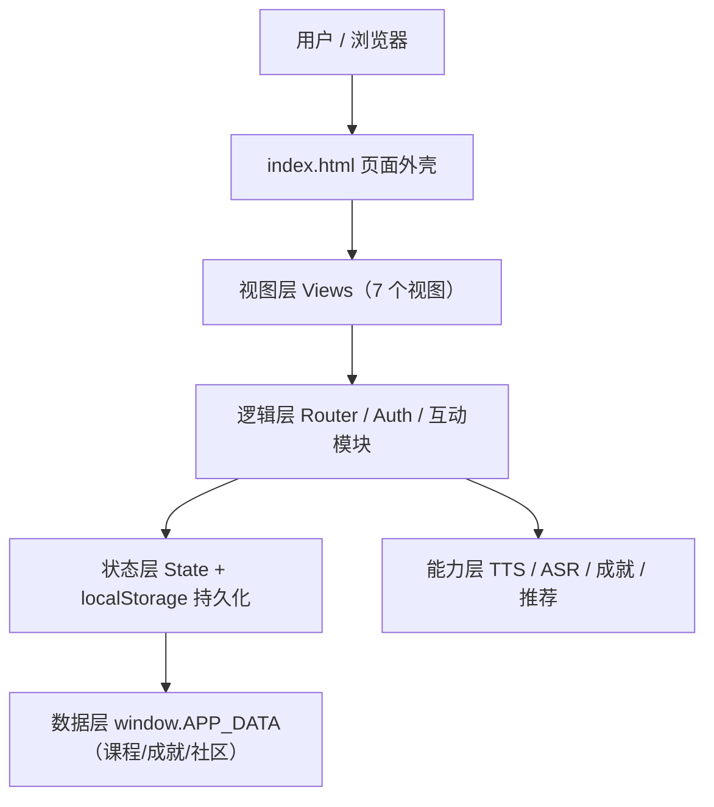
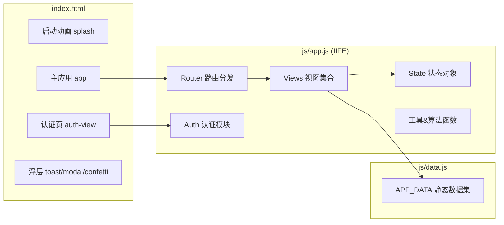

# LinguaVerse 沉浸式多语种学习平台 · 技术文档

> 版本：v1.0.0　|　文档类型：架构设计 / 核心算法 / 部署指南
> 项目定位：支持英语、日语、韩语的在线教育平台，提供分级课程、互动学习、进度追踪、个性化路径与社区激励。

---

## 目录

1. [项目概述](#1-项目概述)
2. [技术选型](#2-技术选型)
3. [系统架构设计](#3-系统架构设计)
4. [模块设计](#4-模块设计)
5. [数据模型](#5-数据模型)
6. [核心算法](#6-核心算法)
7. [关键技术实现](#7-关键技术实现)
8. [部署指南](#8-部署指南)
9. [性能与兼容性](#9-性能与兼容性)
10. [附录](#10-附录)

---

## 1. 项目概述

### 1.1 产品目标
LinguaVerse 是一款面向 C 端学习者的多语种在线学习平台，主打「沉浸式」学习体验，核心能力包括：

| 编号 | 能力 | 实现载体 |
| --- | --- | --- |
| 1 | 分级课程体系 | CEFR A1–C2 六级 × 三语种课程树 |
| 2 | 互动式学习模块 | 单词卡片 / 语法练习 / 听力训练 / 口语跟读 |
| 3 | 学习进度追踪 | 统计看板 + 周活跃柱状图 + 等级环形图 + 连击日历 |
| 4 | 用户注册登录 | localStorage 用户库 + 密码校验 |
| 5 | 个性化学习路径 | 基于进度的推荐引擎 + 里程碑时间线 |
| 6 | 社区交流与成就激励 | 帖子/点赞/排行榜 + 10 枚成就徽章 |

### 1.2 设计原则
- **零构建（Zero-Build）**：纯原生 HTML/CSS/JS，无打包、无依赖、无 Node 运行时。
- **零后端（Pure-Client）**：全部逻辑在前端运行，数据持久化于浏览器 localStorage。
- **渐进增强**：语音合成 / 语音识别在支持的浏览器上启用，不支持时优雅降级并提示。
- **沉浸体验优先**：深色主题为默认、启动动画、翻卡 3D、彩带庆祝、Toast 反馈。

---

## 2. 技术选型

| 层次 | 选型 | 理由 |
| --- | --- | --- |
| 视图层 | 原生 DOM + 模板字符串 | 无框架依赖，加载快，部署简单 |
| 样式层 | 原生 CSS + CSS Variables | 主题切换仅需切换 `data-theme` 属性 |
| 逻辑层 | ES6+（IIFE 模块） | 作用域隔离，避免全局污染 |
| 数据层 | `window.APP_DATA` 静态数据 + `localStorage` 动态数据 | 课程内容内置、用户数据本地持久化 |
| 语音输出 | Web Speech API `speechSynthesis` | 浏览器原生 TTS，无需音频资源 |
| 语音输入 | Web Speech API `SpeechRecognition` | 浏览器原生 ASR，实现口语跟读评分 |
| 部署 | 任意静态文件服务器 | 无服务端逻辑 |

---

## 3. 系统架构设计

### 3.1 总体架构

采用**单页应用（SPA）+ 分层架构**，自下而上分为数据层、状态层、逻辑层、视图层：



### 3.2 运行时结构



### 3.3 目录结构

```
/workspace
├── index.html              # 页面外壳：启动动画 / 认证页 / 主应用 / 浮层容器
├── css/
│   └── styles.css          # 全部样式：主题变量 / 布局 / 组件 / 动画 / 响应式
└── js/
    ├── data.js             # 静态数据层：语言 / 等级 / 课程 / 成就 / 社区种子
    └── app.js              # 应用主逻辑：状态 / 认证 / 路由 / 视图 / 算法
```

### 3.4 视图路由表

| 路由 key | 视图函数 | 职责 | 依赖导航参数 |
| --- | --- | --- | --- |
| `home` | `Views.home` | 学习中心首页 | `profile.targetLang` |
| `courses` | `Views.courses` | 分级课程浏览 | `nav.lang`, `nav.level` |
| `learn` | `Views.learn` / `Views.learnModule` | 互动学习入口 / 学习执行 | `nav.lessonId` |
| `progress` | `Views.progress` | 进度追踪看板 | — |
| `path` | `Views.path` | 个性化学习路径 | `profile.targetLang` |
| `community` | `Views.community` | 学习社区 | — |
| `profile` | `Views.profile` | 个人中心与成就墙 | `State.user` |

---

## 4. 模块设计

### 4.1 状态管理模块 `State`

```js
const State = {
  user: null,    // 当前登录用户名
  view: 'home',  // 当前视图
  nav: {         // 导航上下文
    lang: 'english', level: 'A1', lessonId: null, moduleIdx: 0
  },
  data: {}       // 预留：当前用户数据缓存
};
```

- `loadState()` / `saveState()`：将 `{user, view, nav}` 序列化到 `localStorage`，实现刷新后恢复现场。
- 用户业务数据（XP、进度、成就等）与登录态**分离存储**，按用户名隔离。

### 4.2 认证模块 `Auth`

| 方法 | 说明 |
| --- | --- |
| `switchTab(tab)` | 登录 / 注册表单切换 |
| `login(form)` | 校验用户存在性与密码，写入 `State.user`，调用 `enterApp()` |
| `register(form)` | 创建用户档案（随机头像 + 目标语言 + 起始等级），初始化 `freshData()` |
| `logout()` | 清空登录态，回到认证页 |

**安全说明**：密码以**明文**存于 localStorage，仅用于演示。生产环境必须改为服务端鉴权 + 密码哈希（如 bcrypt）。（详见 [9.3 安全建议](#93-安全建议)）

### 4.3 视图模块 `Views`

7 个视图均为「命令式渲染函数」：清空 `#main-view` → 通过 `el()` 工具拼接 DOM → 绑定事件。切换视图时带 `viewIn` 入场动画。

### 4.4 互动学习模块

按课程 `type` 分派到四种渲染器：

| 课程类型 | 渲染函数 | 交互方式 | 完成条件 |
| --- | --- | --- | --- |
| `vocabulary` | `renderFlashcard` | 点击翻转卡片 + TTS 朗读 | 浏览完所有单词 |
| `grammar` | `renderGrammar` | 单选 + 即时正误反馈 | 答完所有题 |
| `listening` | `renderListening` | 播放音频 + 选择题 | 答完所有题 |
| `speaking` | `renderSpeaking` | 播放范读 + 语音识别跟读 | 跟读完所有句 |

---

## 5. 数据模型

### 5.1 静态数据 `APP_DATA`（js/data.js）

```js
APP_DATA = {
  languages:  { english|japanese|korean: { name, nativeName, flag, color, learners } },
  levels:     [ { code:'A1', name:'入门', desc, xp:0, color } ... C2 ],
  courses:    { <lang>: { <level>: { title, goal, lessons:[...] } } },
  achievements: [ { id, icon, name, desc, xp, tier } ],   // 10 枚
  dailyChallenges: [ { id, name, xp, type } ],             // 4 项
  community:  { posts:[...], leaderboard:[...] }
}
```

**课程 `lesson` 结构（按 type 区分字段）：**

```js
// vocabulary
{ id, title, type:'vocabulary', words:[{ word, trans, phonetic, example }] }
// grammar
{ id, title, type:'grammar',
  grammar:{ point, rule, examples:[...] },
  exercises:[{ q, options:[...], answer:Number, explain }] }
// listening
{ id, title, type:'listening',
  audio:[{ text, trans }],
  questions:[{ q, options:[...], answer:Number }] }
// speaking
{ id, title, type:'speaking', sentences:[{ en, zh }] }
```

### 5.2 动态数据（localStorage）

| Key | 内容 | 写入时机 |
| --- | --- | --- |
| `linguaverse_state_v1` | `{user, view, nav}` 会话现场 | 每次路由/登录变化 |
| `linguaverse_users_v1` | `{ username: { password, profile, data } }` 用户库 | 注册/数据更新 |
| `linguaverse_posts_v1` | 社区帖子数组 | 发帖/点赞 |
| `linguaverse_theme` | `'dark'` / `'light'` | 主题切换 |

**用户业务数据 `data`（由 `freshData()` 初始化）：**

```js
{
  xp:0, streak:0, lastActiveDate:null,
  completedLessons:[],        // 已完成课程 id
  lessonProgress:{},          // { lessonId: { idx } } 断点续学
  wordsLearned:0, grammarDone:0, listenDone:0,
  speakCount:0, perfectQuizzes:0, postsCount:0,
  langsStudied:[],            // 已学习语言
  achievements:[],            // 已解锁成就 id
  dailyDone:[], dailyDate:null,   // 每日挑战状态
  weekActivity:{},            // { 'YYYY-MM-DD': xp } 活跃度
  quizHistory:[], joinDate
}
```

---

## 6. 核心算法

### 6.1 等级（Level）映射算法

通过**阈值遍历**将 XP 映射到 CEFR 等级，并计算当前等级内的完成度。

```js
function currentLevel(xp) {          // 返回 xp 所属的最大等级
  let cur = DATA.levels[0];
  for (const lv of DATA.levels) if (xp >= lv.xp) cur = lv;
  return cur;
}
function nextLevel(xp) {             // 返回下一个更高等级（无则 null）
  for (const lv of DATA.levels) if (xp < lv.xp) return lv;
  return null;
}
function levelProgress(xp) {         // 当前等级内进度百分比
  const cur = currentLevel(xp), nxt = nextLevel(xp);
  if (!nxt) return { pct:100, cur, nxt:null, remain:0 };
  const span = nxt.xp - cur.xp;
  const got  = xp - cur.xp;
  return { pct: Math.round(got/span*100), cur, nxt, remain: nxt.xp - xp };
}
```

**等级阈值表：** A1=0 / A2=500 / B1=1500 / B2=3000 / C1=5000 / C2=8000。

**复杂度：** O(L)，L=6（常数级）。

### 6.2 连续学习（Streak）算法

以「自然日」为粒度，比较最后活跃日期与今日的间隔，实现连击累加 / 中断重置。

```js
function touchStreak() {
  const d = userData(); if (!d) return;
  const today = todayStr();                       // 'YYYY-MM-DD'
  if (d.lastActiveDate === today) return;         // 今日已计入，幂等
  const gap = d.lastActiveDate ? daysBetween(d.lastActiveDate, today) : null;
  if (gap === 1)      d.streak += 1;              // 昨日活跃 → 续连
  else if (gap > 1 || gap === null && d.streak === 0) d.streak = 1; // 断连/首次 → 重置
  else if (!d.lastActiveDate) d.streak = 1;
  d.lastActiveDate = today;
  d.weekActivity[today] = d.weekActivity[today] || 0;
  saveUserData(d);
}
```

**边界处理：**
- 同一天多次触发 → 幂等，不重复累加。
- 间隔 >1 天 → 连击重置为 1。
- `daysBetween` 使用 `T00:00:00` 本地零点对齐，规避时区导致的跨日误判。

### 6.3 经验值（XP）结算算法

```js
function addXp(amount) {
  const d = userData(); const before = currentLevel(d.xp).code;
  d.xp += amount;
  d.weekActivity[todayStr()] = (d.weekActivity[todayStr()] || 0) + amount; // 记账
  saveUserData(d);
  if (before !== currentLevel(d.xp).code) {   // 跨越阈值 → 升级
    toast('🎉 升级！'); confetti();
  }
}
```

**XP 来源表：**

| 行为 | XP |
| --- | --- |
| 完成一节课 | +60 |
| 完成每日挑战 | +20 |
| 社区发帖 | +10 |
| 解锁成就 | 见成就定义（50–800） |

### 6.4 成就解锁判定算法

采用**条件表 + 去重授予**模式，`tryAward` 保证同一成就只授予一次，授予即追加对应 XP。

```js
function checkAchievements(d) {
  const earned = new Set(d.achievements), newOnes = [];
  const tryAward = (id, cond) => {
    if (cond && !earned.has(id)) {
      earned.add(id);
      const a = DATA.achievements.find(x => x.id === id);
      if (a) { d.xp += a.xp; newOnes.push(a); }   // 授予即结算 XP
    }
  };
  tryAward('first-word', d.wordsLearned >= 1);
  tryAward('streak-3',   d.streak  >= 3);
  // ...9 条规则
  d.achievements = Array.from(earned);
  return newOnes;                                 // 返回本次新解锁项
}
```

> 可扩展性：新增成就只需在 `DATA.achievements` 添加定义并追加一行 `tryAward`。

### 6.5 口语跟读评分算法（相似度）

对语音识别回传文本与目标句做**字符集合重叠率**（Jaccard 变体）计算，>60% 判定为「跟读成功」。

```js
function similarity(a, b) {
  if (!a || !b) return 0;
  if (a === b) return 1;                    // 完全一致
  const setA = new Set(a.split(''));
  let common = 0;
  for (const ch of setA) if (b.includes(ch)) common++;   // 交集大小
  return common / Math.max(setA.size, new Set(b.split('')).size); // 交/并
}
```

- 评分前先剥离标点（`.,!?。、！？`）并统一小写。
- 判定阈值 `sim > 0.6` → 计入 `speakCount`。
- **局限**：该算法为字符级近似，非音素级对齐；后续可替换为 Levenshtein 距离或音素编辑距离以提升精度。

### 6.6 个性化推荐算法

基于「当前目标语言 + 完成情况 + 弱项」的**规则引擎**，产出推荐序列。

```
输入：targetLang, completedLessons, dailyDone, speakCount, achievements
规则（按优先级）：
  R1 下一节未完成课程        ← 遍历该语言课程树，取首个未完成
  R2 未完成的每日挑战        ← dailyChallenges \ dailyDone
  R3 弱项补强（口语<5 次）   ← 提升 speakCount
  R4 成就引导（徽章<3 枚）   ← 剩余成就提醒
输出：截断至 limit 条，渲染为可点击卡片
```

### 6.7 课程解锁算法

采用**线性解锁**：仅当上一节完成或为第一节时才可进入，否则置灰锁定。

```js
const prevDone = i === 0 || d.completedLessons.includes(course.lessons[i-1].id);
const state = done ? 'done' : (prevDone ? 'open' : 'locked');
```

### 6.8 排行榜合并算法

将当前用户动态注入静态榜单，按 XP 降序重排并刷新名次，实现「我在第几」实时反馈。

```js
board.push({ name: user+'(我)', xp: d.xp, streak: d.streak, me:true });
board.sort((a,b) => b.xp - a.xp);
board.forEach((u,i) => u.rank = i+1);
```

---

## 7. 关键技术实现

### 7.1 语音合成（TTS）

```js
function speak(text, lang) {
  speechSynthesis.cancel();                       // 打断上一次朗读
  const u = new SpeechSynthesisUtterance(text);
  u.lang = { english:'en-US', japanese:'ja-JP', korean:'ko-KR' }[lang] || 'en-US';
  u.rate = 0.85;                                  // 放慢语速利于跟读
  const match = voicesCache.find(v => v.lang === u.lang)
             || voicesCache.find(v => v.lang.startsWith(u.lang.slice(0,2)));
  if (match) u.voice = match;                     // 精确匹配 → 语言前缀兜底
  speechSynthesis.speak(u);
}
```

**要点：** 语音列表异步加载，通过 `onvoiceschanged` 事件刷新缓存 `voicesCache`。

### 7.2 语音识别（ASR）

```js
const rec = new (SpeechRecognition || webkitSpeechRecognition)();
rec.lang = 'en-US' | 'ja-JP' | 'ko-KR';
rec.continuous = false;       // 单次识别
rec.interimResults = false;   // 仅取最终结果
rec.onresult = e => { /* 取 e.results[0][0].transcript → similarity 评分 */ };
```

**降级策略：** 不支持时按钮提示「请使用 Chrome」，不阻塞学习流程。

### 7.3 主题切换

```js
html[data-theme="dark"]  { --bg:#0b1020; --text:#eef2ff; ... }
html[data-theme="light"] { --bg:#f4f6ff; --text:#0f172a; ... }
```

所有颜色以 CSS 变量定义，切换仅改根属性，无需重绘组件逻辑；偏好持久化到 localStorage。

### 7.4 断点续学

每次翻卡/答题/跟读推进时写入 `lessonProgress[lessonId].idx`，重新进入课程时 `Math.min(idx, total-1)` 恢复到上次位置。

---

## 8. 部署指南

### 8.1 环境要求

| 项 | 要求 |
| --- | --- |
| 运行环境 | 任意静态文件服务器（无需 Node / 数据库） |
| 浏览器 | Chrome / Edge（完整体验）；Firefox / Safari（无 ASR，其余可用） |
| HTTPS | **语音识别必须 HTTPS 或 localhost**（浏览器安全策略要求） |

### 8.2 本地开发部署

```bash
# 方式一：Python 内置服务器（推荐快速验证）
cd /workspace
python3 -m http.server 8080 --bind 0.0.0.0
# 访问 http://localhost:8080/index.html

# 方式二：Node（如已安装）
npx serve -l 8080 /workspace

# 方式三：PHP
php -S 0.0.0.0:8080 -t /workspace
```

### 8.3 生产环境部署

**A. Nginx 静态托管**

```nginx
server {
    listen 443 ssl http2;
    server_name linguaverse.example.com;

    ssl_certificate     /etc/ssl/certs/fullchain.pem;
    ssl_certificate_key /etc/ssl/private/privkey.pem;   # HTTPS 以启用语音识别

    root /var/www/linguaverse;
    index index.html;

    location / {
        try_files $uri $uri/ /index.html;               # SPA 回退
    }
    # 静态资源长缓存
    location ~* \.(css|js|png|jpg|svg|woff2)$ {
        expires 30d;
        add_header Cache-Control "public, immutable";
    }
    gzip on;
    gzip_types text/css application/javascript application/json;
}
```

**B. 主流静态平台（一行发布）**

| 平台 | 命令 / 方式 |
| --- | --- |
| Vercel | `vercel --prod`（根目录直接部署） |
| Netlify | `netlify deploy --prod --dir=/workspace` |
| GitHub Pages | 推送至 `gh-pages` 分支，Settings → Pages 启用 |
| 对象存储（S3/OSS/COS） | 上传三个文件，开启静态网站托管，绑定 CDN + HTTPS |

> 若部署为**子路径**（如 `example.com/app/`），需将 `index.html` 中的 `/css/`、`/js/` 改为相对路径 `./css/`、`./js/`。

### 8.4 部署检查清单

- [ ] `index.html`、`css/styles.css`、`js/data.js`、`js/app.js` 四个文件均可 200 访问
- [ ] 站点已启用 **HTTPS**（否则口语跟读不可用）
- [ ] SPA 回退已配置（`try_files ... /index.html`）
- [ ] 静态资源已开启 gzip/br 压缩与缓存
- [ ] 目标设备已安装目标语言的系统语音包（TTS/ASR 依赖系统语音引擎）
- [ ] 生产环境已替换本地鉴权为服务端方案（见 9.3）

### 8.5 资源体积与加载

| 文件 | 约体积 | 说明 |
| --- | --- | --- |
| index.html | ~7.7 KB | 页面外壳 |
| css/styles.css | ~20 KB | 全量样式 |
| js/data.js | ~15 KB | 课程与成就数据 |
| js/app.js | ~55 KB | 应用逻辑 |
| **合计** | **~100 KB** | 无需外部依赖，首屏即刻可用 |

---

## 9. 性能与兼容性

### 9.1 性能策略
- 无框架、无 Virtual DOM，直接 DOM 操作，首屏渲染开销极低。
- 静态数据内联，避免网络请求瀑布。
- 动画统一走 CSS `transform` / `opacity`，触发 GPU 合成层，避免 layout 抖动。
- 视图切换前清空容器，防止 DOM 泄漏；`setTimeout` 动画元素用完即 `remove()`。

### 9.2 兼容性矩阵

| 能力 | Chrome | Edge | Firefox | Safari |
| --- | --- | --- | --- | --- |
| 全部核心学习功能 | ✅ | ✅ | ✅ | ✅ |
| TTS 语音合成 | ✅ | ✅ | ✅ | ✅ |
| ASR 语音识别 | ✅ | ✅ | ❌ | ⚠️ 部分 |

### 9.3 安全建议（生产化改造）

当前为纯前端演示实现，上线前必须补强：

1. **鉴权服务化**：注册/登录改由后端 API 处理，密码用 bcrypt/Argon2 哈希加盐存储。
2. **会话令牌**：改用 HttpOnly + Secure Cookie 的 JWT/Session，替代 localStorage 登录态。
3. **数据落库**：学习进度、成就、帖子迁移至数据库（用户表/进度表/成就表/帖子表）。
4. **内容风控**：社区发帖接入敏感词过滤与审核机制。
5. **传输安全**：全站 HTTPS + HSTS；静态资源加 SRI。

### 9.4 可扩展方向
- 接入真实音频与真人发音（替代 TTS），提升沉浸感。
- 引入音素级发音评分（替换 6.5 的字符相似度）。
- 后端化：Node/Go API + PostgreSQL + Redis 排行榜。
- 引入 WebRTC 实现真人外教口语房间。

---

## 10. 附录

### 10.1 localStorage 键总览

| Key | 版本后缀 | 用途 |
| --- | --- | --- |
| `linguaverse_state_v1` | v1 | 会话现场 |
| `linguaverse_users_v1` | v1 | 用户库 |
| `linguaverse_posts_v1` | v1 | 社区帖子 |
| `linguaverse_theme` | — | 主题偏好 |

> 版本后缀用于未来数据结构升级时平滑迁移。

### 10.2 关键函数索引

| 函数 | 位置 | 职责 |
| --- | --- | --- |
| `currentLevel` / `nextLevel` / `levelProgress` | `js/app.js` | 等级与进度计算 |
| `touchStreak` / `daysBetween` | `js/app.js` | 连续学习算法 |
| `addXp` | `js/app.js` | 经验结算与升级 |
| `checkAchievements` / `awardAchievements` | `js/app.js` | 成就判定与授予 |
| `similarity` | `js/app.js` | 跟读相似度评分 |
| `speak` / `getRecognition` | `js/app.js` | TTS / ASR 封装 |
| `renderFlashcard/Grammar/Listening/Speaking` | `js/app.js` | 四大互动模块渲染 |
| `renderRecommendations` / `renderMilestones` | `js/app.js` | 个性化路径 |
| `Router.go` / `Views.*` | `js/app.js` | 路由与视图分发 |

### 10.3 术语表

| 术语 | 含义 |
| --- | --- |
| CEFR | 欧洲语言共同参考框架，A1–C2 六级语言能力标准 |
| XP | 经验值，用于驱动等级成长与激励 |
| Streak | 连续学习天数连击 |
| TTS / ASR | 文本转语音 / 语音转文本 |
| SPA | 单页应用 |

---

*文档结束。*
